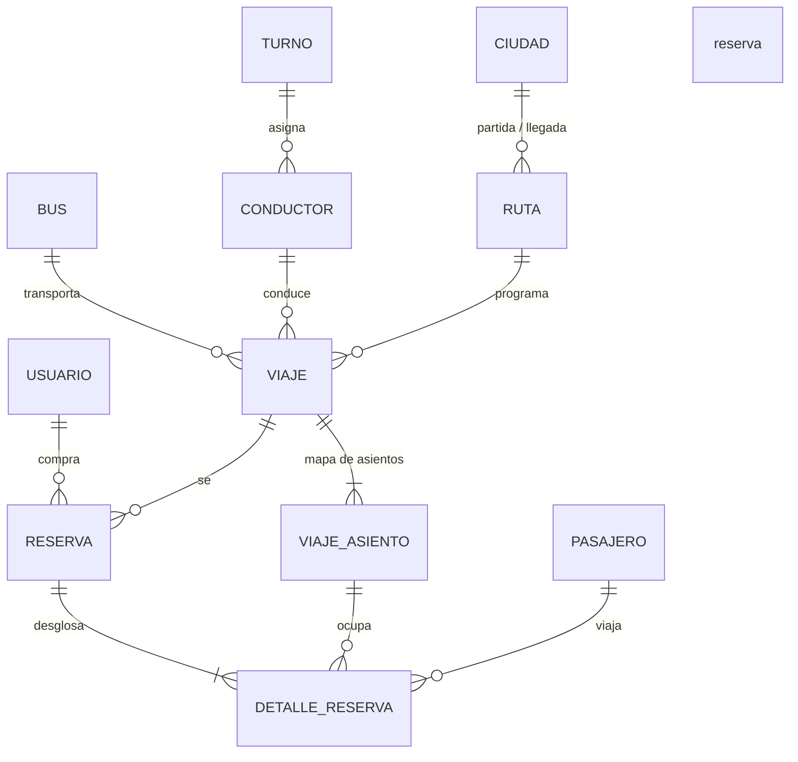
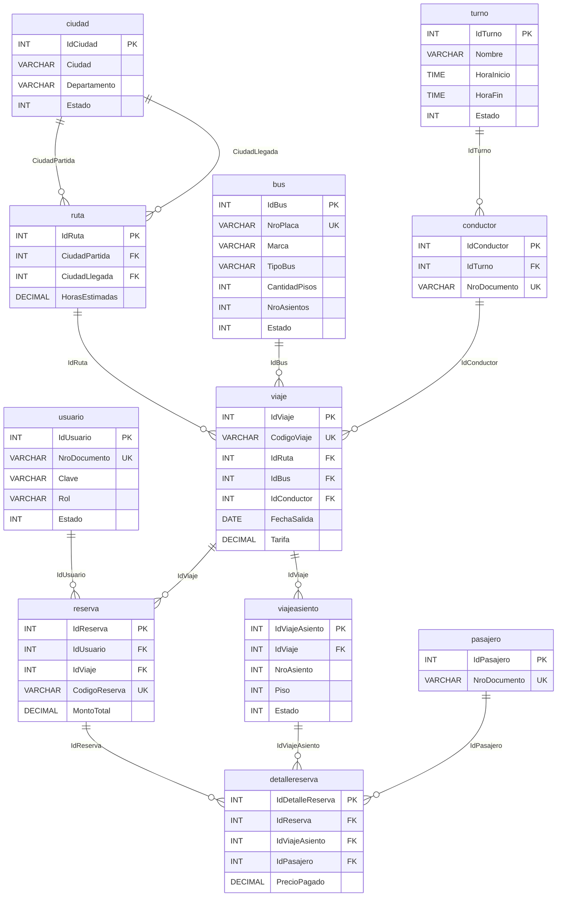

# 7.3. Diseño de base de datos y persistencia JPA

**Proyecto:** CiberBus — reserva de pasajes de transporte terrestre  
**Curso:** 5484 Lenguaje de Programación II  
**Motor:** MySQL 8 — esquema `bd_reserva_buses`  
**ORM:** Jakarta Persistence (JPA) + Hibernate + Spring Data JPA  

En este subpunto se presenta el diseño de la base de datos y la forma en que se conecta con la aplicación mediante JPA. Se alinea con el Tema 1 (persistencia de objetos, ORM, entidades, anotaciones, JPQL y relaciones). Cada tabla de `bd_reserva_buses` tiene su clase en `com.ciberbus.entity`: el programador trabaja con objetos (`Viaje`, `Reserva`) y Hibernate genera el SQL.

No basta con capturas: abajo se explica la relación entre el modelo relacional y las clases Java.

---

## 7.3.1. Enfoque de persistencia (ORM)

Se usa el **mapeo objeto-relacional (ORM)** de JPA:

| Concepto del Tema 1 | Cómo se aplica en CiberBus |
|---|---|
| Persistencia de objetos | Las entidades se guardan con `repository.save()`; Hibernate genera el `INSERT`/`UPDATE`. |
| Entidad | Cada clase en `com.ciberbus.entity` lleva `@Entity`. |
| Tabla | `@Table(name = "...")` apunta al nombre real en MySQL. |
| Identidad | `@Id` + `@GeneratedValue(strategy = IDENTITY)` = `AUTO_INCREMENT`. |
| Relaciones | Solo `@ManyToOne` + `@JoinColumn` (lado de la FK). |
| JPQL | Consultas en `ViajeRepository` y `ReservaRepository` (`JOIN FETCH`). |

Los nombres de columna se mantienen **tal cual** en MySQL (`IdCiudad`, `NroPlaca`) gracias a `PhysicalNamingStrategyStandardImpl`. Así el modelo físico y las entidades coinciden campo a campo.

La aplicación **no** usa `@OneToOne` ni `@ManyToMany`. Las relaciones del negocio son “muchos a uno” (varios viajes usan una ruta; varios detalles pertenecen a una reserva). El lado “uno a muchos” se consulta por repositorio (`listarAsientos(idViaje)`), no con colecciones bidireccionales, para evitar `LazyInitializationException` con `open-in-view: false`.

---

## 7.3.2. Modelo lógico de base de datos

El modelo lógico describe **entidades del negocio** y sus cardinalidades, sin tipos físicos.

**Catálogo:** Ciudad, Turno, Bus, Conductor, Ruta.  
**Operación:** Viaje, ViajeAsiento.  
**Personas:** Usuario (quien compra), Pasajero (quien viaja).  
**Transacción:** Reserva y DetalleReserva (un asiento + un pasajero).



Reglas de negocio reflejadas en el lógico:

- Una **ruta** une dos **ciudades distintas** (partida ≠ llegada).
- Un **viaje** combina ruta + bus + conductor + fecha/hora + tarifa.
- Cada viaje genera su **mapa de asientos** (`viajeasiento`). Estado `1` = libre, `0` = ocupado.
- Una **reserva** la hace un **usuario** (logueado o invitado `GUEST`) sobre un viaje.
- Cada asiento de la reserva lleva **un pasajero** (máximo 5 asientos por reserva).

---

## 7.3.3. Modelo físico de base de datos

Motor: **MySQL 8**, charset `utf8mb4`, collation `utf8mb4_spanish_ci`.  
Esquema: **`bd_reserva_buses`**.  
Claves primarias: `INT AUTO_INCREMENT`.  
FKs: `CONSTRAINT fk_* FOREIGN KEY`.



Índices únicos relevantes: `NroPlaca`, `NroDocumento` (usuario, pasajero, conductor), `CodigoViaje`, `CodigoReserva`, `(IdViaje, NroAsiento, Piso)`, `(IdReserva, IdViajeAsiento)`.

---

## 7.3.4. Correspondencia tabla MySQL ↔ clase Java

| Tabla MySQL | Clase JPA | Paquete |
|---|---|---|
| `ciudad` | `Ciudad` | `com.ciberbus.entity` |
| `turno` | `Turno` | `com.ciberbus.entity` |
| `bus` | `Bus` | `com.ciberbus.entity` |
| `usuario` | `Usuario` | `com.ciberbus.entity` |
| `pasajero` | `Pasajero` | `com.ciberbus.entity` |
| `conductor` | `Conductor` | `com.ciberbus.entity` |
| `ruta` | `Ruta` | `com.ciberbus.entity` |
| `viaje` | `Viaje` | `com.ciberbus.entity` |
| `viajeasiento` | `ViajeAsiento` | `com.ciberbus.entity` |
| `reserva` | `Reserva` | `com.ciberbus.entity` |
| `detallereserva` | `DetalleReserva` | `com.ciberbus.entity` |

Esa tabla es la evidencia de que **no hay tablas huérfanas**: las 11 tablas del script existen como entidades.

---

## 7.3.5. Diccionario de datos

### Tabla 4.1. Diccionario de `ciudad`

| Campo | Tipo de dato | Clave | Descripción |
|---|---|---|---|
| IdCiudad | INT | PK | Identificador único de la ciudad. |
| Ciudad | VARCHAR(100) | | Nombre de la ciudad. |
| Departamento | VARCHAR(100) | | Departamento o región. |
| Estado | INT | | 1 = activo, 0 = inactivo. |

### Tabla 4.2. Diccionario de `turno`

| Campo | Tipo de dato | Clave | Descripción |
|---|---|---|---|
| IdTurno | INT | PK | Identificador del turno laboral. |
| Nombre | VARCHAR(50) | | Nombre del turno (diurno, nocturno). |
| HoraInicio | TIME | | Hora de inicio. |
| HoraFin | TIME | | Hora de fin. |
| Estado | INT | | 1 = activo, 0 = inactivo. |

### Tabla 4.3. Diccionario de `bus`

| Campo | Tipo de dato | Clave | Descripción |
|---|---|---|---|
| IdBus | INT | PK | Identificador del bus. |
| NroPlaca | VARCHAR(15) | UK | Placa única. |
| Marca | VARCHAR(50) | | Marca del vehículo. |
| TipoBus | VARCHAR(50) | | Cama, semi cama, económico. |
| CantidadPisos | INT | | Número de pisos. |
| NroAsientos | INT | | Capacidad de asientos. |
| Estado | INT | | 1 = operativo. |

### Tabla 4.4. Diccionario de `usuario`

| Campo | Tipo de dato | Clave | Descripción |
|---|---|---|---|
| IdUsuario | INT | PK | Identificador del usuario. |
| TipoDocumento | VARCHAR(30) | | DNI, pasaporte, etc. |
| NroDocumento | VARCHAR(20) | UK | Documento de login. |
| Nombre | VARCHAR(50) | | Nombre. |
| Apellido | VARCHAR(50) | | Apellido. |
| Correo | VARCHAR(100) | UK | Correo único. |
| Clave | VARCHAR(100) | | Hash BCrypt de la contraseña. |
| Telefono | VARCHAR(20) | | Teléfono. |
| FechaNacimiento | DATE | | Fecha de nacimiento. |
| Nacionalidad | VARCHAR(50) | | Nacionalidad. |
| Genero | VARCHAR(10) | | Género. |
| Rol | VARCHAR(20) | | `ADMIN` o `CLIENTE`. |
| Estado | INT | | 1 = habilitado. |

### Tabla 4.5. Diccionario de `pasajero`

| Campo | Tipo de dato | Clave | Descripción |
|---|---|---|---|
| IdPasajero | INT | PK | Identificador del pasajero. |
| TipoDocumento | VARCHAR(30) | | Tipo de documento. |
| NroDocumento | VARCHAR(20) | UK | Documento del viajero. |
| Nombre | VARCHAR(100) | | Nombre. |
| Apellido | VARCHAR(100) | | Apellido. |
| Correo | VARCHAR(150) | UK | Correo. |
| Telefono | VARCHAR(20) | | Teléfono. |
| FechaNacimiento | DATE | | Fecha de nacimiento. |
| Nacionalidad | VARCHAR(50) | | Nacionalidad. |
| Genero | VARCHAR(20) | | Género. |
| Estado | INT | | 1 = activo. |

### Tabla 4.6. Diccionario de `conductor`

| Campo | Tipo de dato | Clave | Descripción |
|---|---|---|---|
| IdConductor | INT | PK | Identificador del conductor. |
| TipoDocumento | VARCHAR(20) | | Tipo de documento. |
| NroDocumento | VARCHAR(20) | UK | Documento único. |
| Nombre | VARCHAR(100) | | Nombre. |
| Apellido | VARCHAR(100) | | Apellido. |
| Correo | VARCHAR(150) | UK | Correo. |
| Telefono | VARCHAR(20) | | Teléfono. |
| CategoriaLicencia | VARCHAR(20) | | Categoría de licencia. |
| VencimientoLicencia | DATE | | Vencimiento. |
| IdTurno | INT | FK → turno | Turno asignado. |
| DiaDescanso | VARCHAR(20) | | Día de descanso. |
| Estado | INT | | 1 = activo. |

### Tabla 4.7. Diccionario de `ruta`

| Campo | Tipo de dato | Clave | Descripción |
|---|---|---|---|
| IdRuta | INT | PK | Identificador de la ruta. |
| CiudadPartida | INT | FK → ciudad | Ciudad de origen. |
| CiudadLlegada | INT | FK → ciudad | Ciudad de destino. |
| HorasEstimadas | DECIMAL(4,2) | | Duración estimada. |
| Estado | INT | | 1 = vigente. |

### Tabla 4.8. Diccionario de `viaje`

| Campo | Tipo de dato | Clave | Descripción |
|---|---|---|---|
| IdViaje | INT | PK | Identificador del viaje. |
| CodigoViaje | VARCHAR(20) | UK | Código visible (ej. CB-2409). |
| IdRuta | INT | FK → ruta | Ruta del viaje. |
| IdBus | INT | FK → bus | Bus asignado. |
| IdConductor | INT | FK → conductor | Conductor asignado. |
| FechaSalida | DATE | | Fecha de salida. |
| HoraSalida | TIME | | Hora de salida. |
| FechaLlegada | DATE | | Fecha de llegada. |
| HoraLlegada | TIME | | Hora de llegada. |
| Tarifa | DECIMAL(6,2) | | Precio por asiento (S/). |
| Estado | INT | | 1 = programado. |

### Tabla 4.9. Diccionario de `viajeasiento`

| Campo | Tipo de dato | Clave | Descripción |
|---|---|---|---|
| IdViajeAsiento | INT | PK | Identificador del asiento en ese viaje. |
| IdViaje | INT | FK → viaje | Viaje al que pertenece. |
| NroAsiento | INT | UK compuesto | Número de asiento. |
| Piso | INT | UK compuesto | Piso (1 o 2). |
| Estado | INT | | 1 = libre, 0 = ocupado. |

### Tabla 4.10. Diccionario de `reserva`

| Campo | Tipo de dato | Clave | Descripción |
|---|---|---|---|
| IdReserva | INT | PK | Identificador de la reserva. |
| IdUsuario | INT | FK → usuario | Comprador (o invitado). |
| IdViaje | INT | FK → viaje | Viaje reservado. |
| CodigoReserva | VARCHAR(20) | UK | Código de autogestión (ej. CB-EE30058D). |
| FechaReserva | DATETIME | | Momento de la compra. |
| MontoTotal | DECIMAL(8,2) | | Total pagado. |
| MetodoPago | VARCHAR(50) | | TARJETA, YAPE_PLIN, EFECTIVO. |
| Estado | VARCHAR(20) | | CONFIRMADA u otro. |

### Tabla 4.11. Diccionario de `detallereserva`

| Campo | Tipo de dato | Clave | Descripción |
|---|---|---|---|
| IdDetalleReserva | INT | PK | Identificador del detalle. |
| IdReserva | INT | FK → reserva | Reserva padre. |
| IdViajeAsiento | INT | FK → viajeasiento | Asiento ocupado. |
| IdPasajero | INT | FK → pasajero | Pasajero de ese asiento. |
| PrecioPagado | DECIMAL(6,2) | | Tarifa cobrada en esa butaca. |

---

## 7.3.6. Script SQL de creación de tablas

El script oficial está en el repositorio:

`sql/00_bd_reserva_buses.sql`

Crea la base, las 11 tablas, PK, UK, FK y el `CHECK` de ciudades distintas en `ruta`. Datos de prueba: `sql/01_datos_prueba.sql` y `sql/02_viajes_prueba_sep_nov_2026.sql`.

Fragmento representativo (viaje + asiento + reserva):

```sql
CREATE TABLE viaje (
    IdViaje INT AUTO_INCREMENT PRIMARY KEY,
    CodigoViaje VARCHAR(20) NOT NULL,
    IdRuta INT NOT NULL,
    IdBus INT NOT NULL,
    IdConductor INT NOT NULL,
    FechaSalida DATE NOT NULL,
    HoraSalida TIME NOT NULL,
    FechaLlegada DATE NOT NULL,
    HoraLlegada TIME NOT NULL,
    Tarifa DECIMAL(6,2) NOT NULL,
    Estado INT NOT NULL DEFAULT 1,
    CONSTRAINT uq_viaje_codigo UNIQUE (CodigoViaje),
    CONSTRAINT fk_viaje_ruta FOREIGN KEY (IdRuta) REFERENCES ruta(IdRuta),
    CONSTRAINT fk_viaje_bus FOREIGN KEY (IdBus) REFERENCES bus(IdBus),
    CONSTRAINT fk_viaje_conductor FOREIGN KEY (IdConductor) REFERENCES conductor(IdConductor)
);

CREATE TABLE viajeasiento (
    IdViajeAsiento INT AUTO_INCREMENT PRIMARY KEY,
    IdViaje INT NOT NULL,
    NroAsiento INT NOT NULL,
    Piso INT NOT NULL,
    Estado INT NOT NULL DEFAULT 1,
    CONSTRAINT fk_viajeasiento_viaje FOREIGN KEY (IdViaje) REFERENCES viaje(IdViaje),
    CONSTRAINT uq_viajeasiento UNIQUE (IdViaje, NroAsiento, Piso)
);
```

En el informe se adjunta el archivo completo `00_bd_reserva_buses.sql`.

---

## 7.3.7. Evidencia de la base de datos creada en MySQL

Motor verificado: **MySQL 8.4**, esquema `bd_reserva_buses`. Tablas existentes:

```
bus
ciudad
conductor
detallereserva
pasajero
reserva
ruta
turno
usuario
viaje
viajeasiento
```

Consulta usada:

```sql
SHOW TABLES FROM bd_reserva_buses;
```

**Para el Word:** abrir MySQL Workbench → esquema `bd_reserva_buses` → capturar (1) el listado de tablas, (2) el diseño de `viaje` o `reserva` con las FK, (3) unas filas de `ciudad` / `viaje`. Pegar esas tres capturas debajo de este párrafo.

---

## 7.3.8. Clases entidad del proyecto y anotaciones JPA

Todas las entidades viven en `src/main/java/com/ciberbus/entity`. Ejemplo de entidad simple (`Ciudad`) y de entidad con relación (`Viaje`).

```java
@Entity
@Table(name = "ciudad")
public class Ciudad {

    @Id
    @GeneratedValue(strategy = GenerationType.IDENTITY)
    @Column(name = "IdCiudad")
    private Integer idCiudad;

    @Column(name = "Ciudad", nullable = false, length = 100)
    private String ciudad;
    // ...
}
```

```java
@Entity
@Table(name = "viaje")
public class Viaje {

    @Id
    @GeneratedValue(strategy = GenerationType.IDENTITY)
    @Column(name = "IdViaje")
    private Integer idViaje;

    @ManyToOne(optional = false)
    @JoinColumn(name = "IdRuta", nullable = false)
    private Ruta ruta;

    @ManyToOne(optional = false)
    @JoinColumn(name = "IdBus", nullable = false)
    private Bus bus;
    // ...
}
```

### Anotaciones utilizadas

| Anotación | Para qué |
|---|---|
| `@Entity` | Declara la clase como persistente. |
| `@Table(name = "...")` | Nombre físico de la tabla. |
| `@Id` | Clave primaria. |
| `@GeneratedValue(IDENTITY)` | Autonumérico de MySQL. |
| `@Column` | Nombre, `nullable`, `length`, `unique`, `precision`/`scale`. |
| `@ManyToOne` | Relación N:1 hacia otra entidad. |
| `@JoinColumn` | Columna FK en esta tabla. |
| `@UniqueConstraint` | En `ViajeAsiento`: único (IdViaje, NroAsiento, Piso). |

No se usan `@OneToOne` ni `@ManyToMany` porque el modelo no tiene esas cardinalidades. El equivalente a `@OneToMany` se resuelve en el repositorio (consulta por FK), no en la entidad.

---

## 7.3.9. Relaciones entre entidades

| Relación de negocio | JPA | Columnas |
|---|---|---|
| Varios conductores → un turno | `@ManyToOne` en `Conductor` | `IdTurno` |
| Varias rutas → ciudad partida | `@ManyToOne` en `Ruta` | `CiudadPartida` |
| Varias rutas → ciudad llegada | `@ManyToOne` en `Ruta` | `CiudadLlegada` |
| Varios viajes → una ruta | `@ManyToOne` en `Viaje` | `IdRuta` |
| Varios viajes → un bus | `@ManyToOne` en `Viaje` | `IdBus` |
| Varios viajes → un conductor | `@ManyToOne` en `Viaje` | `IdConductor` |
| Varios asientos → un viaje | `@ManyToOne` en `ViajeAsiento` | `IdViaje` |
| Varias reservas → un usuario | `@ManyToOne` en `Reserva` | `IdUsuario` |
| Varias reservas → un viaje | `@ManyToOne` en `Reserva` | `IdViaje` |
| Varios detalles → una reserva | `@ManyToOne` en `DetalleReserva` | `IdReserva` |
| Varios detalles → un asiento | `@ManyToOne` en `DetalleReserva` | `IdViajeAsiento` |
| Varios detalles → un pasajero | `@ManyToOne` en `DetalleReserva` | `IdPasajero` |

`@ManyToOne` es **EAGER** por defecto en JPA: al cargar un `Viaje` se trae su `Ruta`, y de ahí las `Ciudad`. En listados se usa además **JPQL con `JOIN FETCH`** para no depender de la sesión abierta (`spring.jpa.open-in-view: false`).

Ejemplo JPQL (`ReservaRepository`):

```java
@Query("SELECT r FROM Reserva r "
     + "JOIN FETCH r.usuario u "
     + "JOIN FETCH r.viaje v "
     + "JOIN FETCH v.ruta ru "
     + "JOIN FETCH ru.ciudadPartida cp "
     + "JOIN FETCH ru.ciudadLlegada cl "
     + "WHERE r.codigoReserva = :codigoReserva")
Optional<Reserva> findByCodigoReservaWithDetails(String codigoReserva);
```

Eso es persistencia de objetos + JPQL del Tema 1: se navega el grafo `reserva.viaje.ruta.ciudadPartida` sin escribir SQL de joins a mano.

---

## 7.3.10. Evidencia de conexión entre la aplicación y la base de datos

Archivo: `src/main/resources/application.yml`

```yaml
spring:
  datasource:
    url: jdbc:mysql://localhost:3306/bd_reserva_buses?useSSL=false&allowPublicKeyRetrieval=true&serverTimezone=America/Lima
    username: root
    password: 1234
  jpa:
    hibernate:
      ddl-auto: update
      naming:
        physical-strategy: org.hibernate.boot.model.naming.PhysicalNamingStrategyStandardImpl
    show-sql: true
    open-in-view: false
```

- **JDBC:** Spring Boot crea el `DataSource` (HikariCP) hacia `localhost:3306/bd_reserva_buses`.
- **JPA/Hibernate:** `ddl-auto: update` alinea el esquema si falta alguna columna; el diseño canónico es el script SQL.
- **Naming:** no convierte `IdCiudad` a `id_ciudad`.
- **SQL visible:** `show-sql: true` y `logging.level.org.hibernate.SQL: debug`.

Dependencias en `pom.xml`: `spring-boot-starter-data-jpa` y `mysql-connector-j`.

Los repositorios (`CiudadRepository`, `ViajeRepository`, `ReservaRepository`, …) extienden `JpaRepository<Entidad, Integer>`. El service llama al repository; el controller **no** habla con la base.

**Evidencia para el informe (capturas):**

1. MySQL Workbench con `bd_reserva_buses` y las 11 tablas.
2. Arranque de Spring Boot: líneas `HikariPool-1 - Starting...` y `Started CiberbusApplication`.
3. Un `Hibernate:` `select ... from viaje` o `insert into reserva` en la consola al buscar un viaje o confirmar una reserva.
4. Código de `application.yml` + una entidad + un `@Query`.

Si la clave local no es `1234`, se usa `application-local.yml` (no se versiona) sin cambiar el diseño.

---

## 7.3.11. Cierre del subpunto

CiberBus tiene un modelo relacional de 11 tablas en MySQL y 11 entidades JPA en `com.ciberbus.entity`. Cada FK del script es un `@ManyToOne` + `@JoinColumn`. Las consultas de viajes y reservas usan JPQL con `JOIN FETCH`. La conexión se configura por `spring.datasource` y Spring Data JPA. Con eso se cubre persistencia de objetos, ORM, anotaciones, relaciones y JPQL del Tema 1.
